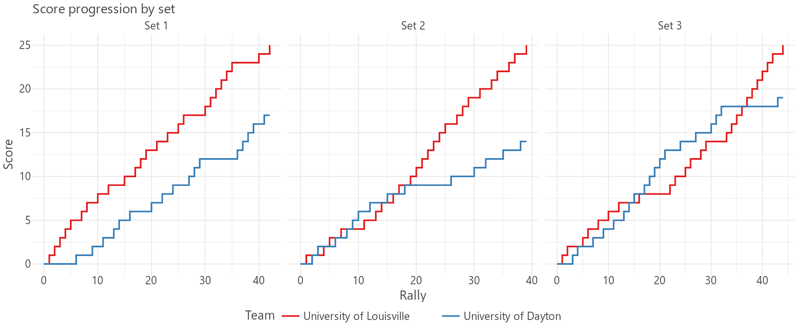

# py-datavolley

Parse DataVolley `.dvw` scouting files into Python dictionaries for volleyball analysis.

**Python 3.11+ · Zero runtime dependencies · Optional interactive charts**

## Install

```bash
uv add openvolley-pydatavolley
```

For charts with [Lets-Plot](https://lets-plot.org/), install the `viz` extra:

```bash
uv add "openvolley-pydatavolley[viz]"
```

## Quick start

Read a bundled match and select its attacks:

```python
import datavolley as dv

plays = dv.read_plays(dv.example_file())
attacks = [play for play in plays if play["skill"] == "Attack"]

print(f"{len(plays)} events, {len(attacks)} attacks")
```

Replace `dv.example_file()` with your own file path to analyze another match.

### Read multiple DVW files

`dv.example_file_list()` returns a list of paths to all bundled DVW files. Use `extend()` to collect every file's plays in one flat list:

```python
import datavolley as dv

dvw_files = dv.example_file_list()

all_plays = []
for dvw_file in dvw_files:
    all_plays.extend(dv.read_plays(dvw_file))

print(f"{len(dvw_files)} files, {len(all_plays)} events")
```

dvw_files = [str(path) for path in sorted(match_folder.glob("*.dvw"))]

```

Replace `C:\path\to\matches` with the folder containing your `.dvw` files, then use the same `extend()` loop above.

Each row retains `source_file`. Include it alongside `match_id`, `set_number` and `rally_number` when grouping rallies across files.

Plays are plain dictionaries: work with them directly or pass them to pandas or Polars. Normalized readers convert numeric fields to Python numbers, trim strings, use `None` for missing data, and derive zones from scout codes when available.

## Choose a reader

Start with `read_plays()` for play-focused analysis.

| Function | Output | Best for |
| --- | --- | --- |
| `read_plays(path)` | 50-field normalized analysis rows, including `source_file` | Filtering plays and rallies, grouping, summaries, and reports |
| `read_raw_plays(path)` | Raw scout rows plus `source_file` | Inspecting scout codes and columns with minimal enrichment |
| `read_dv(path)` | Full 88-field normalized play rows | Coordinates, video/event times, complete lineups, and detailed scout fields |
| `load_dvw(path)` | Full match dictionary, including normalized plays | Match metadata, rosters, set scores, and results |

Readers retain all scout events, including points, timeouts, substitutions, and lineup records. Filter after reading to preserve rally, possession, score, and phase context.

### Select complete rallies

Using `plays` and `attacks` from the quick start, keep every event in rallies containing a winning attack:

```python
winning_attacks = [play for play in attacks if play["winning_attack"]]
rallies = {(play["set_number"], play["rally_number"]) for play in winning_attacks}
selected = [
    play for play in plays if (play["set_number"], play["rally_number"]) in rallies
]
```

### Inspect raw scout rows

```python
import datavolley as dv

rows = dv.read_raw_plays(dv.example_file())
print(rows[0]["code"], rows[0]["file_line_number"], rows[0]["source_file"])
```

Raw rows include scout codes, phase columns, event flags, rotation slots, coordinates, video times, event datetimes, line numbers, and running scores. Numeric scout columns such as scores and rotation slots remain strings. Team/player names, decoded skills, and derived rally/point/possession identifiers are not added.

## Plotting

[**Open the interactive demo →**](https://openvolley.github.io/py-datavolley/)

[](https://openvolley.github.io/py-datavolley/)

GitHub displays the static preview above; the linked HTML page runs the interactive Lets-Plot chart. The example uses point events, so each rally contributes one score update and unplayed sets are omitted.

<details>
<summary>Recreate the plot</summary>

With the `viz` extra installed:

```python
import datavolley as dv
from lets_plot import (
    LetsPlot,
    aes,
    facet_wrap,
    geom_step,
    ggplot,
    ggsize,
    labs,
    theme,
    theme_minimal,
)

points = [play for play in dv.read_plays(dv.example_file()) if play["point"]]
rows = {"set": [], "rally": [], "team": [], "score": []}
for play in points:
    set_label = f"Set {play['set_number']}"
    teams = [play["home_team"], play["visiting_team"]]
    if play["rally_number"] == 1:
        rows["set"] += [set_label] * 2
        rows["rally"] += [0, 0]
        rows["team"] += teams
        rows["score"] += [0, 0]
    rows["set"] += [set_label] * 2
    rows["rally"] += [play["rally_number"]] * 2
    rows["team"] += teams
    rows["score"] += [play["home_team_score"], play["visiting_team_score"]]

fig = (
    ggplot(rows, aes("rally", "score", color="team"))
    + geom_step()
    + facet_wrap("set", ncol=3, scales="free_x")
    + labs(title="Score progression by set", x="Rally", y="Score", color="Team")
    + theme_minimal()
    + theme(legend_position="bottom")
    + ggsize(960, 400)
)

LetsPlot.setup_show_ext()
fig.show()
```

`fig.show()` opens the interactive chart in your default browser. To save it instead, use `fig.to_html("score-progression.html")`. Without a path, `fig.to_html()` returns the HTML as a string. Use `fig.to_png("score-progression.png")` for a static image.

The same example is available as [`examples/score_progression.py`](examples/score_progression.py). From a repository checkout, regenerate the preview and demo with:

```bash
uv run --extra viz python examples/score_progression.py
```

The script writes both assets to `docs/`. To publish the demo, set GitHub **Settings → Pages → Deploy from a branch → `main` → `/docs`** after the files are on `main`.

</details>

## Full match data

Use `load_dvw()` when you need match metadata alongside the plays:

```python
import datavolley as dv

match = dv.load_dvw(dv.example_file())
print(match["teams"])
print(match["match_result"])
```

| Key | Type | Contents |
| --- | --- | --- |
| `filename` | `str` | Input filename without its extension |
| `match_date` | `datetime` or `None` | Match date and time, if available |
| `match_id` | `str` | Match identifier from the file, or a generated fallback |
| `comments` | `str` | Match comments; empty if absent |
| `teams` | `dict` | Home/visiting team names and IDs |
| `set_scores` | `dict[str, int]` | Final scores by team and set |
| `players` | `dict[str, list[dict]]` | Rosters under `home` and `visiting` |
| `attack_combinations` | `list[dict]` | Attack codes and descriptions |
| `setter_calls` | `list[dict]` | Setter-call definitions |
| `plays` | `list[dict]` | The same normalized rows returned by `read_dv()` |
| `match_result` | `dict` | Sets won, sets played, and match winner; empty if scores are absent |

### Nested fields

Expand a section for every field returned inside that match entry. Types below distinguish source metadata from normalized play rows: roster shirt numbers and player IDs remain strings, while their play-row equivalents are integers or `None`.

<details>
<summary><code>teams</code> — 4 fields</summary>

Keys are added for each successfully parsed team line. Missing or invalid team lines can leave the dictionary empty or omit that team's keys.

| Field | Type | Description |
| --- | --- | --- |
| `team_1_id` | `int` or `None` | Home team ID; `None` if the source ID is not numeric |
| `team_1` | `str` or `None` | Home team name |
| `team_2_id` | `int` or `None` | Visiting team ID; `None` if the source ID is not numeric |
| `team_2` | `str` or `None` | Visiting team name |

</details>

<details>
<summary><code>set_scores</code> — score keys for each parsed set</summary>

Set numbers start at 1. Only sets with parseable final scores are included; missing scores produce an empty dictionary.

| Field pattern | Type | Description |
| --- | --- | --- |
| `team_1_set_{n}` | `int` | Home team's final score in set `n`, for example `team_1_set_1` |
| `team_2_set_{n}` | `int` | Visiting team's final score in set `n`, for example `team_2_set_1` |

</details>

<details>
<summary><code>players</code> — roster containers and all 7 player fields</summary>

Both roster keys are always present, with empty lists when no players are parsed for that side.

| Field | Type | Description |
| --- | --- | --- |
| `home` | `list[dict]` | Home team roster |
| `visiting` | `list[dict]` | Visiting team roster |

Each player dictionary contains:

| Field | Type | Description |
| --- | --- | --- |
| `team` | `str` or `None` | Team name; falls back to `Home` or `Visiting` if the team-name key is absent |
| `player_number` | `str` | Shirt number as stored, including leading zeros; defaults to `"0"` if absent |
| `player_id` | `str` | Source player ID; falls back to `player_{player_number}` if absent |
| `last_name` | `str` or `None` | Player's last name |
| `first_name` | `str` or `None` | Player's first name |
| `role` | `str` or `None` | Role code from the roster, without decoding |
| `full_name` | `str` or `None` | Available first and last names joined with a space |

</details>

<details>
<summary><code>attack_combinations</code> — all 12 fields per definition</summary>

An empty list means no valid attack definitions were parsed. `field_*` names identify uninterpreted source columns by zero-based index. `raw_data` retains every semicolon-separated column, including empty strings.

| Field | Type | Description |
| --- | --- | --- |
| `code` | `str` or `None` | Attack-combination code, such as `V5` or `X9` |
| `zone` | `int` or `None` | Numeric zone from the definition |
| `position` | `str` or `None` | Source position code, such as `R`, `L`, or `C` |
| `type` | `str` or `None` | Source attack-type code |
| `description` | `str` or `None` | Human-readable attack description |
| `field_5` | `str` or `None` | Uninterpreted column at index 5; may be an empty string |
| `color_code` | `int` or `None` | Numeric color code |
| `position_code` | `int` or `None` | Numeric position code |
| `set_direction` | `str` or `None` | Source set-direction code, such as `F`, `B`, or `P` |
| `backrow` | `bool` | `True` when the back-row column is `"1"`; otherwise `False` |
| `field_10` | `str` or `None` | Uninterpreted column at index 10; may be an empty string |
| `raw_data` | `list[str]` | Original split source columns |

</details>

<details>
<summary><code>setter_calls</code> — all 12 fields per definition</summary>

An empty list means no valid setter-call definitions were parsed. As with attack combinations, `field_*` columns are retained without interpretation and `raw_data` includes empty source columns.

| Field | Type | Description |
| --- | --- | --- |
| `code` | `str` or `None` | Setter-call code, such as `K1` or `KM` |
| `field_1` | `str` | Uninterpreted column at index 1; may be an empty string |
| `description` | `str` or `None` | Human-readable setter-call description |
| `field_3` | `str` or `None` | Uninterpreted column at index 3; may be an empty string |
| `color_code` | `int` or `None` | Numeric color code |
| `position_1` | `int` or `None` | First numeric position field |
| `position_2` | `int` or `None` | Second numeric position field |
| `position_3` | `int` or `None` | Third numeric position field |
| `additional_codes` | `str` or `None` | Additional codes as a comma-separated source string |
| `field_9` | `int` or `None` | Uninterpreted numeric column at index 9 |
| `raw_data` | `list[str]` | Original split source columns |
| `additional_codes_list` | `list[str]` | Additional codes split and trimmed; empty when none are present |

</details>

<details>
<summary><code>plays</code> — all 88 normalized fields per event</summary>

Every play dictionary has all 88 keys below. An empty list means no scout events were parsed. Missing or unconvertible data uses `None`; event flags are always booleans. These are also the fields returned by `read_dv()`.

**Identifiers and provenance**

| Field | Type | Description |
| --- | --- | --- |
| `match_id` | `str` or `None` | Match identifier, repeated on each event |
| `set_number` | `int` or `None` | Set number from the scout row |
| `rally_number` | `int` or `None` | One-based rally counter within the set, advanced by serves |
| `point_id` | `int` or `None` | Zero-based, match-wide point-group ID; also advances around timeouts |
| `team_touch_id` | `int` or `None` | Zero-based, match-wide group ID; changes on team/point changes or consecutive attacks |
| `possession_number` | `int` or `None` | Possession counter within the rally; the serve starts at 0 |
| `file_line_number` | `int` or `None` | One-based line number in the input file |

**Teams and player**

| Field | Type | Description |
| --- | --- | --- |
| `home_team` | `str` or `None` | Home team name |
| `home_team_id` | `int` or `None` | Home team ID |
| `visiting_team` | `str` or `None` | Visiting team name |
| `visiting_team_id` | `int` or `None` | Visiting team ID |
| `team` | `str` or `None` | Team associated with the event |
| `team_id` | `int` or `None` | ID of the team associated with the event |
| `player_number` | `int` or `None` | Acting player's shirt number |
| `player_name` | `str` or `None` | Roster name; falls back to `Player {player_number}` when only a number is available |
| `player_id` | `int` or `None` | Acting player's roster ID, converted to an integer; nonnumeric IDs become `None` |

**Action and scout codes**

| Field | Type | Description |
| --- | --- | --- |
| `code` | `str` or `None` | Original scout code |
| `skill` | `str` or `None` | Decoded skill, such as `Serve`, `Reception`, `Set`, `Attack`, or `Point` |
| `skill_type` | `str` or `None` | Decoded skill-type description, such as `High ball attack` |
| `skill_subtype` | `str` or `None` | Skill-specific subtype, such as `Hard`, `Tip`, or `Jump Float` |
| `evaluation_code` | `str` or `None` | Evaluation symbol from the scout code, such as `#`, `+`, or `=` |
| `evaluation` | `str` or `None` | Skill-specific evaluation description |
| `attack_code` | `str` or `None` | Attack-combination code for an attack |
| `attack_description` | `str` or `None` | Matching attack definition; `unknown attack code` if no definition matches |
| `set_code` | `str` or `None` | Setter-call code for a set |
| `set_description` | `str` or `None` | Matching setter-call description; `unknown set code` if no definition matches |
| `set_type` | `str` or `None` | Set-type character retained from the scout code |
| `num_players_numeric` | `int` or `None` | Numeric block/reception formation code; not always a literal player count |
| `num_players` | `str` or `None` | Skill-specific description of the numeric formation code |
| `special_code` | `str` or `None` | Decoded, skill/evaluation-specific special-code description |
| `custom_code` | `str` or `None` | Custom trailing data retained from the scout code |

**Zones and coordinates**

Zones and cones follow the file's scouting mode. Raw coordinate strings can retain missing-value sentinels such as `-1-1`; the converted x/y fields are `None` for invalid or missing coordinates. Converted coordinates use the DataVolley plotting scale, with sidelines at x = 0.5/3.5, baselines at y = 0.5/6.5, and the net at y = 3.5.

| Field | Type | Description |
| --- | --- | --- |
| `start_zone` | `int` or `None` | Starting court zone |
| `end_zone` | `int` or `None` | Ending court zone; not filled from an attack cone |
| `end_subzone` | `str` or `None` | Ending subzone code |
| `end_cone` | `int` or `None` | Attack direction cone when the file uses cone scouting |
| `start_coordinate` | `str` or `None` | Raw starting coordinate index |
| `start_coordinate_x` | `float` or `None` | Converted starting x coordinate |
| `start_coordinate_y` | `float` or `None` | Converted starting y coordinate |
| `mid_coordinate` | `str` or `None` | Raw intermediate coordinate index |
| `mid_coordinate_x` | `float` or `None` | Converted intermediate x coordinate |
| `mid_coordinate_y` | `float` or `None` | Converted intermediate y coordinate |
| `end_coordinate` | `str` or `None` | Raw ending coordinate index |
| `end_coordinate_x` | `float` or `None` | Converted ending x coordinate |
| `end_coordinate_y` | `float` or `None` | Converted ending y coordinate |

**Event flags and scores**

| Field | Type | Description |
| --- | --- | --- |
| `point` | `bool` | Event is a point/score record |
| `timeout` | `bool` | Event is a timeout record |
| `substitution` | `bool` | Event is a substitution record; lineup records are excluded from this flag |
| `end_of_set` | `bool` | Event marks the end of a set |
| `winning_attack` | `bool` | Winning attack, including one inferred from a following dig/block error |
| `home_team_score` | `int` or `None` | Home score at the end of the point group, propagated to its events |
| `visiting_team_score` | `int` or `None` | Visiting score at the end of the point group, propagated to its events |
| `home_score_start_of_point` | `int` or `None` | Home score before the point group |
| `visiting_score_start_of_point` | `int` or `None` | Visiting score before the point group |

**Lineups and setter positions**

Lineup shirt numbers come from the scout row. Lineup IDs are resolved against the rosters and normalized to integers; unmatched or nonnumeric IDs become `None`.

| Field | Type | Description |
| --- | --- | --- |
| `home_p1` | `int` or `None` | Home player's shirt number in rotation slot 1 |
| `home_p2` | `int` or `None` | Home player's shirt number in rotation slot 2 |
| `home_p3` | `int` or `None` | Home player's shirt number in rotation slot 3 |
| `home_p4` | `int` or `None` | Home player's shirt number in rotation slot 4 |
| `home_p5` | `int` or `None` | Home player's shirt number in rotation slot 5 |
| `home_p6` | `int` or `None` | Home player's shirt number in rotation slot 6 |
| `visiting_p1` | `int` or `None` | Visiting player's shirt number in rotation slot 1 |
| `visiting_p2` | `int` or `None` | Visiting player's shirt number in rotation slot 2 |
| `visiting_p3` | `int` or `None` | Visiting player's shirt number in rotation slot 3 |
| `visiting_p4` | `int` or `None` | Visiting player's shirt number in rotation slot 4 |
| `visiting_p5` | `int` or `None` | Visiting player's shirt number in rotation slot 5 |
| `visiting_p6` | `int` or `None` | Visiting player's shirt number in rotation slot 6 |
| `home_player_id1` | `int` or `None` | Resolved home player ID in rotation slot 1 |
| `home_player_id2` | `int` or `None` | Resolved home player ID in rotation slot 2 |
| `home_player_id3` | `int` or `None` | Resolved home player ID in rotation slot 3 |
| `home_player_id4` | `int` or `None` | Resolved home player ID in rotation slot 4 |
| `home_player_id5` | `int` or `None` | Resolved home player ID in rotation slot 5 |
| `home_player_id6` | `int` or `None` | Resolved home player ID in rotation slot 6 |
| `visiting_player_id1` | `int` or `None` | Resolved visiting player ID in rotation slot 1 |
| `visiting_player_id2` | `int` or `None` | Resolved visiting player ID in rotation slot 2 |
| `visiting_player_id3` | `int` or `None` | Resolved visiting player ID in rotation slot 3 |
| `visiting_player_id4` | `int` or `None` | Resolved visiting player ID in rotation slot 4 |
| `visiting_player_id5` | `int` or `None` | Resolved visiting player ID in rotation slot 5 |
| `visiting_player_id6` | `int` or `None` | Resolved visiting player ID in rotation slot 6 |
| `home_setter_position` | `int` or `None` | Home setter's rotation position from the scout row |
| `visiting_setter_position` | `int` or `None` | Visiting setter's rotation position from the scout row |
| `setter_position` | `int` or `None` | Setter position for the side identified by the event's team prefix |

**Point and attack context**

| Field | Type | Description |
| --- | --- | --- |
| `point_phase` | `str` or `None` | Scout point phase: `Breakpoint` or `Sideout`; other source codes are retained |
| `attack_phase` | `str` or `None` | Scout attack phase: `Reception`, `Transition breakpoint`, or `Transition sideout`; other codes are retained |
| `phase` | `str` or `None` | Derived play phase: `Serve`, `Reception`, or `Transition` |
| `point_won_by` | `str` or `None` | Name of the team awarded the point |
| `serving_team` | `str` or `None` | Serving team name inferred from the point group's serve |
| `receiving_team` | `str` or `None` | Receiving team name inferred from the serving team |

**Timing**

| Field | Type | Description |
| --- | --- | --- |
| `time` | `datetime` or `None` | Match date combined with the event clock; no timezone information |
| `video_time` | `int` or `None` | Integer video-time value from the scout row |

</details>

<details>
<summary><code>match_result</code> — all 4 result fields</summary>

Calculated from available final set scores. If no scores are available, this entry is an empty dictionary.

| Field | Type | Description |
| --- | --- | --- |
| `team_1_sets_won` | `int` | Number of scored sets won by the home team |
| `team_2_sets_won` | `int` | Number of scored sets won by the visiting team |
| `total_sets_played` | `int` | Number of sets with final scores for both teams |
| `match_winner` | `str` | `team_1`, `team_2`, or `tie`, based on sets won |

</details>

## Data reference

### Analysis fields

`read_plays()` shares field values and types with `read_dv()` and adds `source_file`, the input path as a string. It reads the team/roster and attack/set definitions needed to enrich plays.

<details>
<summary>All 50 analysis fields, grouped by purpose</summary>

| Group | Fields |
| --- | --- |
| Identifiers | `match_id`, `set_number`, `point_id`, `team_touch_id`, `rally_number`, `possession_number` |
| Teams | `home_team`, `home_team_id`, `visiting_team`, `visiting_team_id`, `team`, `team_id` |
| Player | `player_number`, `player_name`, `player_id` |
| Action | `code`, `skill`, `skill_type`, `skill_subtype`, `evaluation_code`, `evaluation` |
| Attack/set | `attack_code`, `attack_description`, `set_code`, `set_description`, `set_type` |
| Zones | `start_zone`, `end_zone`, `end_subzone`, `end_cone` |
| Event flags | `point`, `timeout`, `substitution`, `end_of_set`, `winning_attack` |
| Scores | `home_team_score`, `visiting_team_score`, `home_score_start_of_point`, `visiting_score_start_of_point` |
| Context | `point_phase`, `attack_phase`, `phase`, `point_won_by`, `serving_team`, `receiving_team` |
| Setter positions | `home_setter_position`, `visiting_setter_position`, `setter_position` |
| Provenance | `file_line_number`, `source_file` |

</details>

For the full play schema, use `read_dv()`. The analysis reader skips timestamp and coordinate conversion, lineup extraction/ID resolution, custom/special-code details, and blocker/receiver counts. It also skips match dates, comments, set-score summaries, and match results.

### Sample normalized play

<details>
<summary>Selected fields from a play in the bundled match</summary>

These fields come from one `read_dv()` row, also available through `load_dvw(...)["plays"]`. The full row contains 88 fields.

```python
{
    "match_id": "106859",
    "set_number": 1,
    "rally_number": 12,
    "possession_number": 3,
    "code": "*08EH#~~~~3D~~~+5",
    "team": "University of Louisville",
    "player_number": 8,
    "player_name": "Lexi Hamilton",
    "skill": "Set",
    "evaluation_code": "#",
    "evaluation": "Perfect",
    "end_zone": 3,
    "end_subzone": "D",
    "home_team_score": 9,
    "visiting_team_score": 3,
    "phase": "Transition",
    "winning_attack": False,
    "file_line_number": 241,
}
```

</details>

## About this fork

A modernized fork of [pydatavolley](https://github.com/openvolley/pydatavolley), built with [uv](https://docs.astral.sh/uv/) for package management, [Ruff](https://docs.astral.sh/ruff/) for linting and formatting, and [ty](https://docs.astral.sh/ty/) for type checking.
