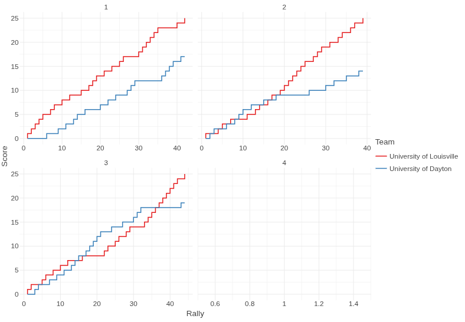

# py-datavolley

A Python package for parsing and analyzing volleyball scouting data from DataVolley files (\*.dvw).

A modernized fork of [pydatavolley](https://github.com/openvolley/pydatavolley) with zero runtime dependencies, built on the [Astral](https://docs.astral.sh/) toolchain: [UV](https://docs.astral.sh/uv/) for package management, [Ruff](https://docs.astral.sh/ruff/) for linting/formatting, and [Ty](https://docs.astral.sh/ty/) for type checking.

## Install

```bash
uv add openvolley-pydatavolley
```

Plotting support via [Lets-Plot](https://lets-plot.org/):

```bash
uv add "openvolley-pydatavolley[viz]"
```

## Usage

```python
import datavolley as dv

plays = dv.read_dv(dv.example_file())
```

Plays come back as plain dicts — feed them straight into pandas/polars or work with them directly. Keeping the output dependency-free was a design goal. Plays are automatically type-normalized: numeric-like fields (scores, rotation slots, zones, rally numbers) come back as `int`/`float`, strings are trimmed, missing values stay `None`, and start/end zones are derived from the scout code when not explicitly scouted.

`load_dvw(file_path)` returns the same normalized plays inside a full match-data dictionary (teams, set scores, players, attack combinations, setter calls).

<details>
<summary>Sample play from <code>read_dv()</code> (one of ~1500 in the bundled example match)</summary>

```json
[
  {
    "match_id": "106859",
    "video_time": 495,
    "code": "a02RM-~~~58AM~~00B",
    "team": "University of Dayton",
    "player_number": 2,
    "player_name": "Maura Collins",
    "player_id": -230138,
    "skill": "Reception",
    "skill_subtype": "Jump Float",
    "skill_type": "Jump-float serve reception",
    "evaluation_code": "-",
    "setter_position": 6,
    "attack_code": null,
    "set_code": null,
    "set_type": null,
    "start_zone": 5,
    "end_zone": 8,
    "end_subzone": "A",
    "num_players_numeric": null,
    "home_team_score": 0,
    "visiting_team_score": 0,
    "home_setter_position": 1,
    "visiting_setter_position": 6,
    "custom_code": "00B",
    "home_p1": 19,
    "home_p2": 9,
    "home_p3": 11,
    "home_p4": 15,
    "home_p5": 10,
    "home_p6": 7,
    "visiting_p1": 1,
    "visiting_p2": 16,
    "visiting_p3": 17,
    "visiting_p4": 10,
    "visiting_p5": 6,
    "visiting_p6": 8,
    "start_coordinate": "0431",
    "mid_coordinate": "-1-1",
    "end_coordinate": "7642",
    "point_phase": "Reception",
    "attack_phase": null,
    "start_coordinate_x": 1.26875,
    "start_coordinate_y": 0.09259259259259262,
    "mid_coordinate_x": null,
    "mid_coordinate_y": null,
    "end_coordinate_x": 1.68125,
    "end_coordinate_y": 5.425925925925926,
    "set_number": 1,
    "home_team": "University of Louisville",
    "visiting_team": "University of Dayton",
    "home_team_id": 17,
    "visiting_team_id": 42,
    "point_won_by": "University of Louisville",
    "serving_team": "University of Louisville",
    "receiving_team": "University of Dayton",
    "rally_number": 1,
    "possession_number": 1
  }
]
```

</details>

## Plotting

With the `viz` extra installed — the flow of the game, score progression between the two teams grouped by set ([Lets-Plot](https://lets-plot.org/)). `fig.show()` writes the plot to a temp file and opens it in your default browser; use `fig.to_html()` instead if you want a persistent HTML file.

```python
import datavolley as dv
from lets_plot import *

LetsPlot.setup_show_ext()

plays = dv.read_dv(dv.example_file())

rows = {"set": [], "rally": [], "team": [], "score": []}
for play in plays:
    rows["set"] += [play["set_number"]] * 2
    rows["rally"] += [play["rally_number"]] * 2
    rows["team"] += [play["home_team"], play["visiting_team"]]
    rows["score"] += [
        play["home_team_score"],
        play["visiting_team_score"],
    ]

fig = (
    ggplot(rows, aes("rally", "score", color="team"))
    + geom_step()
    + facet_wrap("set", scales="free_x")
    + labs(x="Rally", y="Score", color="Team")
    + theme_minimal()
)

fig.show()
```


